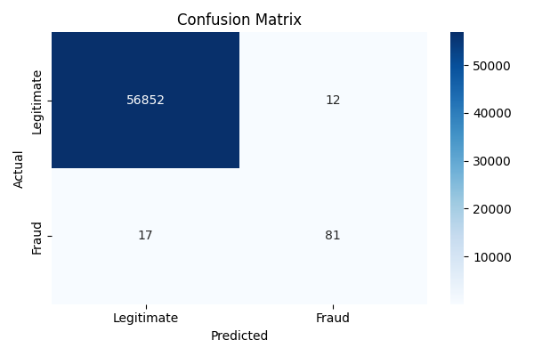
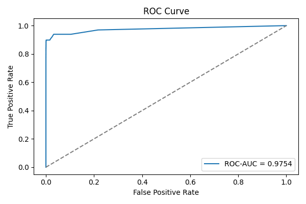

# Fraud Detection on Imbalanced Transactions

Credit-card fraud classifier built for **recall on a 0.17% minority class**: stratified split, leakage-safe scaling, SMOTE on the training set only, and a class-balanced Random Forest. Evaluation skips accuracy on purpose.

## Results

Held-out test set: 56,962 transactions (20% stratified split), 98 of them fraud.

| Metric | Value |
|---|---|
| Precision (fraud) | **0.871** |
| Recall (fraud) | **0.827** |
| F1 (fraud) | **0.848** |
| ROC-AUC | **0.975** |

|  | Predicted legit | Predicted fraud |
|---|---|---|
| **Actual legit** | 56,852 | 12 |
| **Actual fraud** | 17 | **81** |

It catches 81 of 98 frauds and flags 12 legitimate transactions out of 56,864.

<p>


</p>

> Accuracy would be 99.95% here, and it would be almost as high for a model that never predicts fraud. That's why the metrics above are all about the minority class.

## How it works

```
creditcard.csv
  → stratified 80/20 split          (keeps the 0.17% fraud ratio in both sets)
  → StandardScaler fit on train only (no test leakage)
  → SMOTE on train only             (test set stays untouched)
  → RandomForest(n_estimators=200, class_weight="balanced")
  → precision / recall / F1 / ROC-AUC + confusion matrix + ROC curve
```

| File | Role |
|---|---|
| `src/preprocess.py` | Load, stratified split, scaling, SMOTE |
| `src/train.py` | Train the Random Forest and save `models/fraud_rf.pkl` |
| `src/evaluate.py` | Metrics → `results/metrics.csv`, plots → `results/figures/` |
| `main.py` | Runs train + evaluate end to end |

## Run it

```bash
pip install -r requirements.txt

# Dataset: Kaggle "Credit Card Fraud Detection" (ULB), 284,807 rows
mkdir -p data
curl -L -o data/creditcard.csv https://storage.googleapis.com/download.tensorflow.org/data/creditcard.csv

python main.py   # ~2 min on a laptop
```

## Next steps

- Tune the decision threshold on a precision-recall curve instead of using the default 0.5
- Compare against a gradient-boosted model and plain logistic regression
- Use stratified k-fold CV in place of a single split
